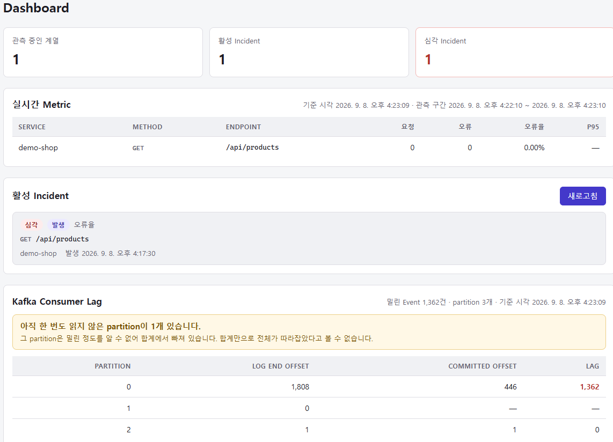
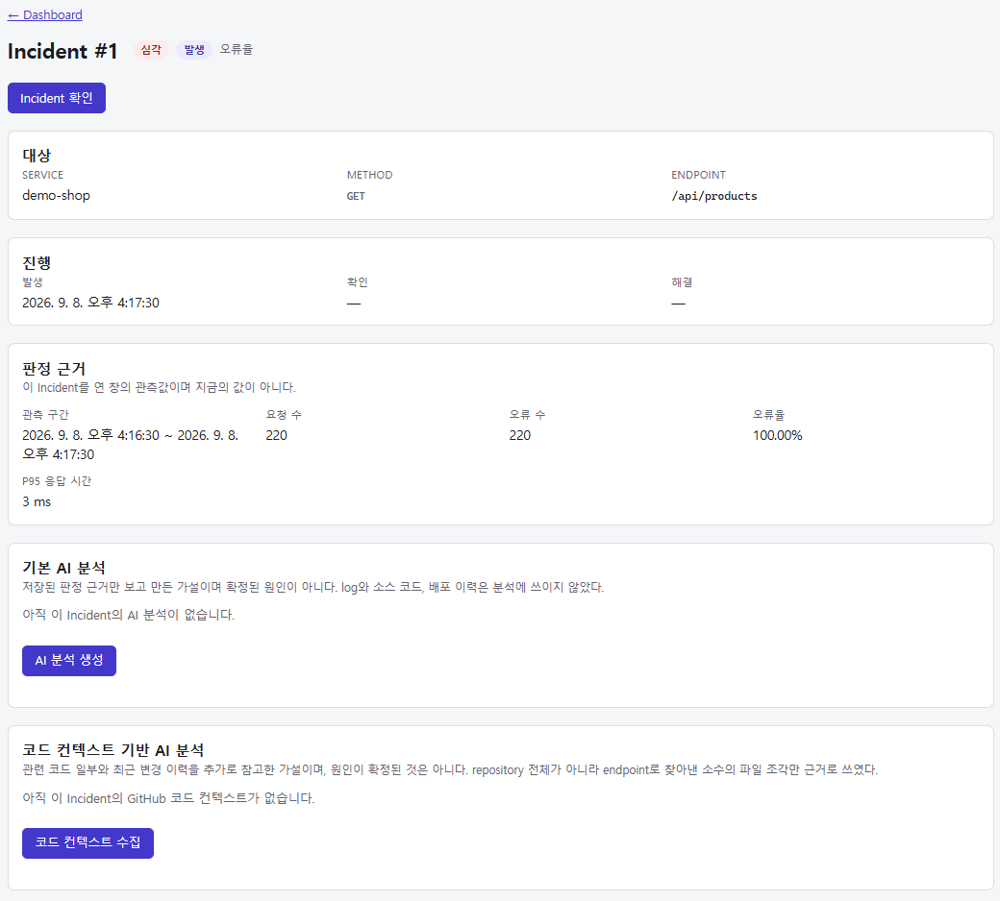
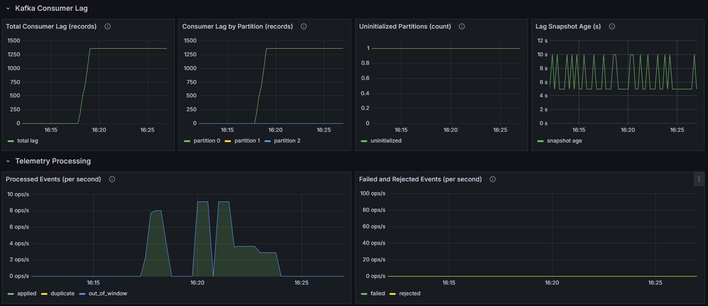
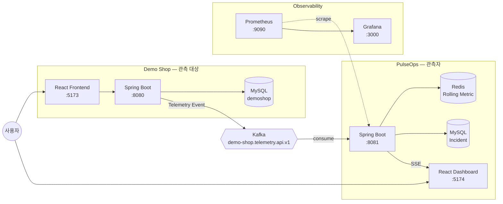

# PulseOps

[](https://github.com/shimjeongho/pulseops/actions/workflows/ci.yml)

Demo Shop에서 발생하는 서비스 Telemetry Event를 Kafka로 모으고, 실시간 Metric을 계산해 이상 상태를
탐지하고 Incident를 관리하는 **이벤트 기반 서비스 모니터링 플랫폼**이다.

두 개의 독립된 Spring Boot Application으로 이루어진다. 둘은 서로의 Database에 직접 접근하지 않으며,
정상 Telemetry 경로는 Kafka Topic `demo-shop.telemetry.api.v1` 하나로만 이어진다. 처리에 실패한
Record는 재시도 뒤 별도의 DLT로 격리한다.

| Application | 역할 |
| --- | --- |
| **Demo Shop** | 관측 대상. 상품, 주문, 결제와 개발용 장애 주입. 요청이 끝날 때마다 Telemetry Event를 Kafka로 보낸다 |
| **PulseOps** | 관측자. Event를 읽어 Metric을 만들고 Incident를 열고 닫으며, 화면과 API로 그 상태를 보여 준다 |

이 프로젝트는 **공개 배포된 서비스가 아니다.** 전체 stack을 로컬 Docker Compose로 띄워 확인한다.
실행 방법은 [Quick Start](#quick-start)에 있다.

## Preview

로컬 Docker Compose 환경에서 장애를 주입해 얻은 실제 화면이다.

### Incident Detection Dashboard



실시간 Metric, 활성 Incident, Kafka Consumer Lag을 한 화면에서 본다. 이 순간 요청 수는 0인데 Incident는
아직 `발생`이다. 트래픽이 멈춘 창은 판정하지 않기 때문이다.

### Incident Evidence



Incident를 연 창의 요청 수 220, 오류 수 220, 오류율 100%, P95 3ms를 그대로 남긴다. P95가 정상인데 열렸다는
점에서 지연이 아니라 오류율로 판정된 Incident임이 드러난다. 아래 두 영역은 AI 분석과 GitHub 코드 컨텍스트의
**진입점**이며, 사람이 실행하기 전까지 결과는 비어 있다.

### Observability



Prometheus와 Grafana로 Consumer Lag, partition별 상태, Telemetry 처리량을 따로 관측한다. 장애 주입 중
한 시점의 snapshot이며 처리 용량이나 평상시 Lag을 뜻하지 않는다. 아직 한 번도 읽지 않은 partition이 있어
합계만으로 전체가 따라잡았는지 판단할 수 없다. 정해진 부하로 측정한 기록은
[Load Validation](#load-validation)에 있다.

## Why PulseOps

**서비스가 아프다는 것을 어떻게 알 것인가.** 이 질문에 답하려면 세 가지를 정해야 한다.

1. **무엇을 관측할 것인가** — 어떤 사실을 남겨야 나중에 판단할 수 있는가
2. **관측이 서비스를 방해하지 않게 하려면** — 관측 때문에 사용자의 주문이 실패하면 안 된다
3. **무엇을 장애로 볼 것인가** — 오류율 몇 %부터가 장애인가, 몇 번 연속이어야 하는가

PulseOps는 이 세 질문에 대한 답을 코드로 만든 것이다. 설계 결정의 근거와 회고는
[docs/portfolio.md](docs/portfolio.md)에 있다.

## Architecture



**PulseOps는 Demo Shop의 Business Database에 접근하지 않는다.** Telemetry 발행은 비동기이고, 실패해도
Demo Shop의 응답을 막지 않는다. 처리에 실패한 Record가 가는 DLT와 Claude / GitHub / Daily Report 경로는
그림에서 뺐다.

경로별 상세 diagram은 [docs/architecture.md](docs/architecture.md)에 있다.

## Core Features

| 기능 | 설명 |
| --- | --- |
| **Telemetry 수집** | `/api/` 요청마다 13-field Event 발행. `endpoint`는 Route Template |
| **Rolling Metric** | Redis에서 10초 Bucket × 6 = 60초 창 집계 |
| **Incident 탐지** | ERROR_RATE / LATENCY 두 종류. 연속 판정 기반 (Scheduler 아님) |
| **Incident 생명주기** | `OPEN → ACKNOWLEDGED → RESOLVED`. 재개방 없음 |
| **실시간 알림** | SSE로 변경 사실 전달 + 20초 heartbeat |
| **신뢰성** | at-least-once + Redis dedup, retry 3회, DLT 격리 |
| **Daily Report** | 하루치 Incident 집계 (유일한 `@Scheduled` 기반 기능) |
| **AI 분석** | Incident 발생 **후 사람이 요청할 때만** 동작하는 사후 원인 가설 생성 |
| **GitHub 코드 맥락** | Incident 이후 관련 소스/commit 수집 (읽기 전용) |
| **Consumer Lag** | Kafka Admin API 기반 읽기 전용 운영 지표 |
| **Observability** | Prometheus custom metric 10종 + Grafana Dashboard |

## Tech Stack

| 영역 | 기술 |
| --- | --- |
| Backend | Spring Boot, Java 21 |
| Messaging | Apache Kafka 4.0 (KRaft) |
| Cache / Realtime State | Redis 8 (Lua script) |
| Database | MySQL 8.4 + Flyway |
| Frontend | React + Vite, oxlint |
| Realtime | Server-Sent Events |
| Observability | Micrometer, Prometheus, Grafana |
| Load Test | k6 |
| Infra | Docker Compose |
| CI | GitHub Actions |
| AI / VCS | Claude API, GitHub API |

## Key Design Decisions

**Telemetry는 요청을 막지 않는다.** Producer는 fail-open이다. 발행에 실패해도 Demo Shop의 응답을
살리므로, 그 대가로 Kafka 장애 구간의 Telemetry는 **유실될 수 있다.**

**소비는 at-least-once, 반영은 중복에 안전하게.** 같은 Event가 다시 와도 Redis dedup(`SET NX`, TTL
900초)이 두 번 세는 것을 막는다. 처리 실패는 500ms 간격 총 3회 시도 뒤 DLT로 격리하고, 계약 위반은
재시도 없이 바로 DLT로 보낸다. 그래서 **end-to-end exactly-once가 아니다.**
→ [docs/reliability.md](docs/reliability.md)

**Incident는 규칙과 숫자가 연다.** 60초 창의 오류율과 P95를 고정 기준선과 비교해 연속으로 판정한다.
Scheduler가 아니라 Event 처리 흐름 위에서 결정한다.
→ [docs/incident-detection.md](docs/incident-detection.md)

**트래픽이 멈추면 Incident는 끝나지 않는다.** 표본이 부족한 창은 healthy가 아니라 판정하지 않는 구간으로
둔다. **조용해진 것과 나아진 것은 다르다.** 트래픽이 적은 서비스에는 맞지 않는 선택이다.

**AI는 장애를 탐지하지 않는다.** Claude를 부르는 자리는 사람이 요청하는 REST endpoint 둘뿐이고, 두
기능 모두 기본값이 꺼짐이다. 결과는 원인이 아니라 `primaryHypothesis`와 `limitations`를 가진 **가설**이며
화면에 **Suggested Analysis**로 표시된다. GitHub 코드 맥락은 파일 3개와 commit 5개의 **부분적 근거**이고
지금의 기본 branch를 읽으므로 Incident 당시의 코드와 다를 수 있다.
→ [docs/ai-github-boundary.md](docs/ai-github-boundary.md)

**관측 표면은 최소로 연다.** Actuator는 `health`와 `prometheus` 둘만 연다. 이 Application에는 인증
계층이 없으므로 여는 것이 곧 공개이고, `env`와 `configprops`를 열면 API key가 그대로 나간다.
Prometheus는 PulseOps만 5초마다 긁는다. → [monitoring/README.md](monitoring/README.md)

## Quick Start

> [!NOTE]
> PulseOps는 현재 공개 배포된 서비스가 아니다. 아래 주소는 인터넷에 열려 있는 링크가 아니라,
> Docker Compose로 전체 stack을 실행한 뒤 **자신의 PC에서** 접근하는 주소다.

```bash
docker compose up -d --build
docker compose ps
```

9개 service가 `healthy`가 되면 준비 완료다. `kafka-init`은 Topic을 만들고 끝나는 service라
`exited (0)`이 정상이다.

### Local URLs

| 주소 | 무엇 |
| --- | --- |
| `http://localhost:5173` | Demo Shop 화면 |
| `http://localhost:5174` | **PulseOps Dashboard** |
| `http://localhost:8081/api/metrics` | Metric API |
| `http://localhost:8081/api/incidents/active` | 처리 중인 Incident |
| `http://localhost:9090` | Prometheus |
| `http://localhost:3000` | Grafana (**PulseOps Overview**) |

JDK와 Node.js는 Host에 없어도 된다. Container 안에서 build한다. MySQL, Redis, Kafka는 Host에 열리지
않으므로 이미 떠 있는 다른 MySQL이나 Redis와 부딪히지 않는다. 기본 실행에는 아무 설정도 필요 없고,
바꿀 것이 있을 때만 `cp .env.example .env`.

내릴 때는 `docker compose down`이다. `-v`를 붙이면 volume 5개가 **전부 지워지고 되돌릴 수 없다.**
Incident 이력, Kafka offset, 중복 방지 Key, Prometheus 시계열이 함께 사라진다.

### 장애를 재현해 보기

장애 주입은 기본이 꺼짐이다. `.env`에 `DEMO_SHOP_FAULT_INJECTION_ENABLED=true`를 넣고
`docker compose up -d --no-deps demo-shop-backend`로 켠 뒤 k6 시나리오를 돌린다.

| 시나리오 | 무엇이 일어나는가 |
| --- | --- |
| `k6 run load-test/k6/error-incident.js` | 503 100% 주입 → 약 20초 뒤 `ERROR_RATE` Incident가 `CRITICAL`로 열린다 |
| `k6 run load-test/k6/latency-incident.js` | 3.5초 지연 주입 → 응답은 200이고 `errorCount`는 0인데 P95만으로 `LATENCY` Incident가 열린다 |
| `k6 run load-test/k6/baseline.js` | 정상 트래픽 복귀 → 약 30초 뒤 Incident가 `RESOLVED`가 된다 |

Dashboard는 새로고침 없이 바뀐다(SSE). 요청을 그냥 멈추면 Incident는 끝나지 않는다.

**20단계 실습 절차는 [docs/demo-guide.md](docs/demo-guide.md)에 있다.**
막히면 [docs/troubleshooting.md](docs/troubleshooting.md)를 본다.

## Validation

### Automated Tests

| 대상 | 결과 |
| --- | --- |
| PulseOps Backend | **820 tests** / 78 classes — 실패 0 |
| Demo Shop Backend | **162 tests** / 17 classes — 실패 0 |
| PulseOps Frontend | `npm ci` + `oxlint` + `vite build` 통과 |
| Demo Shop Frontend | `npm ci` + `oxlint` + `vite build` 통과 |

*(2026-09-08 로컬 실행 기준)* Kafka, Redis, MySQL이 얽히는 동작은 Testcontainers Integration Test로
확인한다.

```bash
cd pulseops/backend  && sh gradlew --no-daemon --console=plain test
cd demo-shop/backend && sh gradlew --no-daemon --console=plain test
```

두 Backend를 **동시에 돌리지 않는다.** Testcontainers가 각각 MySQL, Redis, Kafka를 띄우므로 자원이
겹친다. `> Task :test UP-TO-DATE`가 보이면 실제로 실행되지 않은 것이므로 `cleanTest test`를 쓴다.

### Load Validation

로컬 Docker Compose 환경에서 k6로 네 시나리오를 실행한 기록이다.

| 시나리오 | 요청 수 | 속도 | 결과 |
| --- | --- | --- | --- |
| Baseline | 2,087 | 18.26 /s | p95 9.33ms, p99 11.41ms, 실패 0 — **Incident 미발생** |
| Error Incident | 1,801 | 20.01 /s | 503 100% → **ERROR_RATE CRITICAL** 약 20초 만에 개설 |
| Recovery | 2,087 | 18.26 /s | `OPEN → ACKNOWLEDGED → RESOLVED` 전이 확인 |
| Latency Incident | 541 | 5.79 /s | p95 3.51s, `errorCount` 0 → **LATENCY CRITICAL만** 개설 |

전 구간에서 Kafka record 8,608건과 Redis 반영 8,608건이 일치했고 중복·실패·거절이 모두 0이었다.
최대 관측 Consumer Lag은 1건이다.

> **이 숫자는 특정 로컬 환경의 관측값이다.** 처리 가능한 최대 요청 수도, 운영 환경의 용량도, 어떤
> SLA도 뜻하지 않는다. 부하 속도를 미리 정해 보냈으므로 애초에 한계를 재는 시험이 아니다.

측정 환경, 전체 수치, 병목 분석은 [docs/performance.md](docs/performance.md)에 있다.

### CI

[`.github/workflows/ci.yml`](.github/workflows/ci.yml)이 Pull Request와 main push에서 돈다. 현재 상태는
문서 맨 위의 badge가 보여 준다.

**확인하는 것** — 두 Backend `test`(matrix, 다른 runner), 두 Frontend `npm ci`/`lint`/`build`,
`docker compose config`, 네 image build.

**확인하지 않는 것** — 전체 stack End-to-End(로컬에서 한다), 배포, 외부 API 호출.
CI는 secret을 요구하지 않으며 Pull Request에서 secret 없이 통과해야 한다.

## Project Structure

```
demo-shop/          관측 대상
  backend/          Spring Boot — product, order, payment, telemetry, fault injection
  frontend/         React — 상품/장바구니/주문/결제
pulseops/           관측자
  backend/          Spring Boot — telemetry, metric, incident, report, analysis, github, kafka
  frontend/         React — Dashboard, Incident 상세, Consumer Lag
infra/docker/       MySQL 초기화 script
monitoring/         Prometheus 설정, Grafana provisioning + Dashboard
load-test/k6/       baseline / error-incident / latency-incident
docs/               아래 문서
```

## Documentation

| 문서 | 내용 |
| --- | --- |
| [docs/architecture.md](docs/architecture.md) | 전체 구조와 경로별 diagram |
| [docs/incident-detection.md](docs/incident-detection.md) | 판정 기준선, 연속 규칙, 생명주기 |
| [docs/reliability.md](docs/reliability.md) | 전달 semantics, retry/DLT, failure boundary |
| [docs/ai-github-boundary.md](docs/ai-github-boundary.md) | AI/GitHub의 역할과 한계 |
| [docs/performance.md](docs/performance.md) | 부하 검증 결과와 병목 분석 |
| [docs/demo-guide.md](docs/demo-guide.md) | 20단계 실습 절차 |
| [docs/troubleshooting.md](docs/troubleshooting.md) | 문제 진단 순서 |
| [docs/portfolio.md](docs/portfolio.md) | 설계 결정의 근거와 회고 |
| [monitoring/README.md](monitoring/README.md) | metric 목록과 의미 |
| [load-test/k6/README.md](load-test/k6/README.md) | k6 시나리오 상세 |

## Limitations

**이 프로젝트가 주장하지 않는 것들이다.**

**운영** — production ready가 아니다. 로컬 데모와 검증을 위한 구성이다. 인증/인가 계층이 없다. 모든
구성 요소가 Instance 하나이고 Kafka Broker도 1개, replication factor도 1이다. 자원 한도, 재시작 정책,
backup, 이중화가 정해져 있지 않다. 배포(CD)가 없고 image를 registry로 밀지 않는다.

**Credential** — Docker Compose에는 로컬 실행 편의를 위한 database와 Grafana의 기본 계정값이 있어
`.env` 없이도 stack이 뜬다. 운영에서 쓸 값이 아니다. Claude API key와 GitHub token 같은 외부 credential은
repository에 두지 않고 `.env`나 실행 환경의 환경 변수로만 주입하며, 값이 없으면 두 기능이 꺼진 채로
나머지가 전부 동작한다.

**전달 보장** — end-to-end exactly-once가 아니고 guaranteed delivery도 아니다. Producer가 fail-open이라
Kafka 장애 구간의 Event는 유실된다. Redis가 아픈 구간의 Event는 집계에서 빠질 수 있다.

**성능** — 측정값은 특정 로컬 환경의 관측치이며 최대 처리량도 운영 용량도 SLA도 아니다. 부하 속도를
미리 정해 보냈으므로 포화 지점을 재지 않았다. 계열이 하나뿐이어서 Kafka partition 3개 중 1개만
사용되었고, 이 부하 구간에서는 Consumer Lag이 늘어난 적이 없어 회복 곡선을 관측하지 못했다.

**탐지** — 트래픽이 멈추면 Incident가 저절로 끝나지 않는다. 기준선이 고정값이라 서비스마다 다른 정상
범위를 반영하지 못한다. Demo Shop의 내부 지표(JVM, CPU)를 관측하지 않는다.

**AI** — AI 결과는 가설이지 확정된 원인이 아니다. GitHub 코드 맥락은 부분적 근거이며 Incident 당시의
코드와 다를 수 있다.
