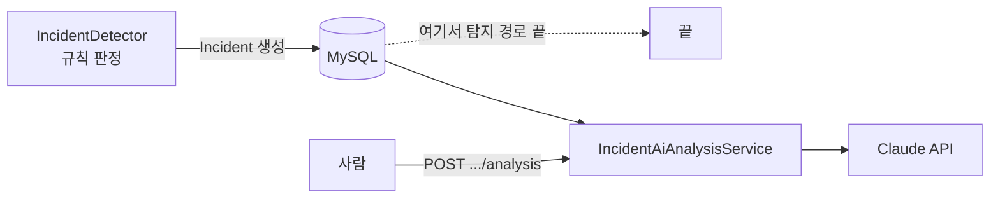
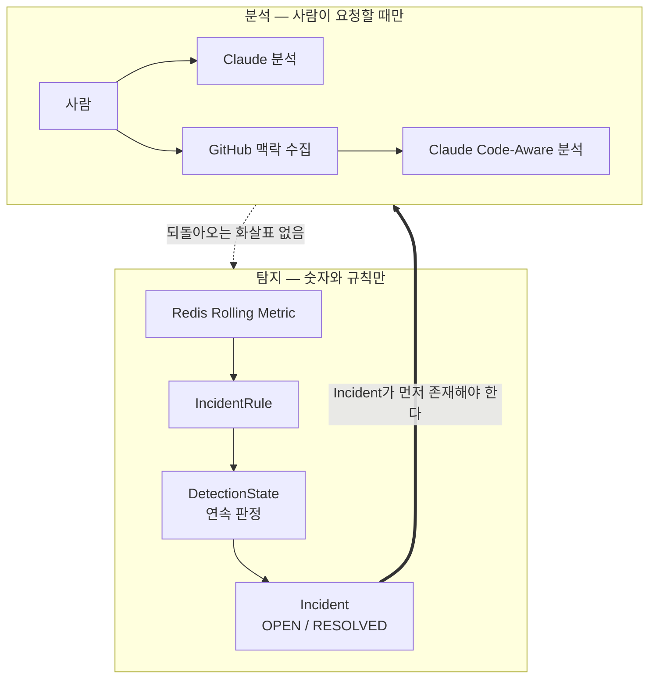

# AI / GitHub Boundary

이 문서는 Claude 분석과 GitHub 코드 맥락 수집이 **무엇을 하고 무엇을 하지 않는지**를 못박는다.

두 기능 모두 **부가 기능**이다. 기본값은 꺼짐이고, 꺼져 있어도 PulseOps의 핵심 기능(Telemetry 수집,
Metric 집계, Incident 탐지, 확인 처리, SSE, Daily Report, Consumer Lag, Prometheus/Grafana)은 전부
그대로 동작한다.

## 1. 한 줄 요약

| 기능 | 역할 |
| --- | --- |
| **Claude** | Incident가 만들어진 **뒤**, 저장된 Evidence를 근거로 **원인 가설**을 생성하는 보조 기능 |
| **GitHub** | Incident **이후** repository 맥락을 모아 그 가설을 보강하는 보조 기능 |

## 2. Claude — 무엇을 하지 않는가

아래 표현은 이 프로젝트의 어떤 문서, 화면, 코드 주석에도 쓰지 않는다.

| 금지 표현 | 왜 사실이 아닌가 |
| --- | --- |
| ~~AI detects failures~~ / ~~AI가 장애를 탐지한다~~ | 탐지는 `IncidentRule`과 `IncidentDetector`의 숫자 판정뿐이다. AI는 탐지 경로에 없다 |
| ~~AI determines incident~~ / ~~AI가 Incident를 판정한다~~ | Incident를 열고 끝내는 것은 규칙이다. AI는 Incident의 상태를 바꾸지 못한다 |
| ~~AI confirms root cause~~ / ~~AI가 원인을 확정한다~~ | 결과는 확정된 원인이 아니라 가설이다 |
| ~~AI automatically fixes incident~~ / ~~AI가 자동으로 복구한다~~ | 이 시스템은 어떤 자동 조치도 하지 않는다 |

### 호출 시점



**시작점은 언제나 사람의 요청이다.**

- Incident가 열릴 때 Claude를 부르지 않는다.
- Scheduler가 Claude를 부르지 않는다.
- SSE 알림이 Claude를 부르지 않는다.
- Consumer가 Claude를 부르지 않는다.

Claude를 부르는 자리는 `POST /api/incidents/{incidentId}/analysis` 하나뿐이다.
GitHub 맥락을 함께 쓰는 `POST /api/incidents/{incidentId}/analysis/github`까지 둘이다.

### 기본값이 꺼짐인 이유

```properties
pulseops.ai.claude.enabled=false
```

이 Application이 외부에 **요금이 발생하는 요청**을 보내는 자리는 여기 하나뿐이다. 켜짐이 기본이면
credential이 없는 환경에서 기동과 테스트가 실패하거나, 아무도 의도하지 않은 요청이 나간다.

꺼져 있을 때의 응답은 다음과 같다.

```json
{
  "status": 503,
  "code": "AI_ANALYSIS_UNAVAILABLE",
  "message": "AI 분석 서비스를 현재 사용할 수 없습니다."
}
```

### 결과 구조

`IncidentAnalysisResult`는 자유 서술이 아니라 정해진 형태를 갖는다.

| field | 내용 | 상한 |
| --- | --- | --- |
| `summary` | 요약 | 2,000자 |
| `primaryHypothesis` | **가장 유력한 가설** (원인이 아니다) | 1,000자 |
| `confidence` | `LOW` / `MEDIUM` / `HIGH` | — |
| `evidence` | 그렇게 본 근거 | 5개 × 400자 |
| `recommendedActions` | 사람이 확인해 볼 것 | 5개 × 400자 |
| `limitations` | **이 분석이 말할 수 없는 것** | 5개 × 400자 |
| `model` | 사용한 model | 100자 |
| `promptVersion` | prompt version | 50자 |
| `inputSnapshot` | 입력으로 준 사실의 요약 | 2,000자 |

`limitations`가 결과의 일부인 것이 중요하다. 분석이 스스로 무엇을 모르는지 말하게 한다.

`confidence`도 마찬가지다. `HIGH`여도 그것은 가설의 확신도이지 사실 여부가 아니다.

`model`과 `promptVersion`과 `inputSnapshot`을 함께 저장하는 이유는, 나중에 이 결과를 다시 봤을 때
**무엇을 주고 무엇으로 받았는지**를 재구성할 수 있어야 하기 때문이다.

### 분석 종류

| `IncidentAnalysisType` | 입력 |
| --- | --- |
| `INCIDENT_ONLY` | Incident와 Metric 근거만 |
| `GITHUB_ENRICHED` | 위 + GitHub 코드 맥락 |

### 화면 표시

UI에서 이 결과는 **Suggested Analysis**로 표시된다. 확정된 원인이 아니라 제안이라는 것이 화면에서
드러나야 한다.

### 사용 model

`pulseops.ai.claude.model`은 코드에 박혀 있지 않고 `CLAUDE_MODEL` 환경 변수에서 온다. 쓸 수 있는
model은 시간이 지나면 바뀌고, 그때 코드를 고쳐 다시 배포해야 한다면 그것은 설정이어야 할 값이 코드에
있는 것이다.

## 3. GitHub — 무엇을 하고 무엇을 하지 않는가

### 하는 일

Incident의 `endpoint`와 관련 있어 보이는 소스 조각과, 발생 직전의 commit 이력을 모은다.

| 수집 항목 | 상한 |
| --- | --- |
| 소스 파일 | **3개** |
| commit | **5개** |
| 소스 조각 총 길이 | **10,000자** |
| code search 조회 크기 | 20건 (그중 3개 선택) |

수집 결과는 `incident_github_context` table에 저장된다.

### 하지 않는 일

| 안 하는 것 | 근거 |
| --- | --- |
| commit 생성 | 읽기 권한만 사용한다 |
| branch 생성 | |
| PR 생성 | |
| 코드 수정 | |
| 자동 복구 | |
| Incident 상태 변경 | |
| 자동 호출 | 사람이 요청했을 때만 동작한다 |

Fine-grained token이라면 대상 repository의 **Contents 읽기**면 충분하다.

### 안전 경계

**1. `source-root` 밖의 파일은 선택하지 않는다.**

```properties
pulseops.github.source-root=${GITHUB_SOURCE_ROOT:demo-shop/backend/src/main/java}
```

어떤 검색 결과로 나와도 이 경로 밖의 파일은 고르지 않는다. repository 전체가 외부 model로 흘러가는
일이 구조적으로 생기지 않는다.

**2. 대상 repository를 요청 본문으로 받지 않는다.**

```properties
pulseops.github.owner=${GITHUB_OWNER:}
pulseops.github.repository=${GITHUB_REPOSITORY:}
```

그 자리를 열면 이 기능이 우리 token으로 아무 repository나 대신 읽어 주는 창구가 된다.

**3. token은 환경 변수에서만 온다.**

`application.properties`에 실제 값을 적지 않는다. 한 번 repository에 들어가면 history에서 지울 수 없다.

**4. rate limit 소진을 감지한다.**

`x-ratelimit-remaining` header가 0이면 그 사실을 구분해 다룬다. 남의 rate limit을 조용히 깎지 않는다.

### 기본값이 꺼짐인 이유

```properties
pulseops.github.enabled=false
```

Claude와 같다. 꺼져 있을 때의 응답은 다음과 같다.

```json
{
  "status": 503,
  "code": "GITHUB_CONTEXT_UNAVAILABLE",
  "message": "GitHub 코드 컨텍스트를 현재 사용할 수 없습니다."
}
```

## 4. GitHub 맥락의 한계 — 반드시 함께 읽을 것

수집된 코드 맥락은 아래 성질을 갖는다. 이것을 모르면 결과를 과신하게 된다.

### 부분적인 근거이다 (partial repository evidence)

파일 3개와 commit 5개다. repository 전체가 아니다. 진짜 원인이 있는 파일이 이 3개에 없을 수 있고,
그때도 분석은 있는 것만 보고 그럴듯한 가설을 만든다.

선택 기준은 "endpoint와 관련 있어 보이는가"이다. **관련 있음이 아니라 관련 있어 보임이다.**

### 과거를 근사할 뿐이다 (historical approximation)

수집은 **지금** 일어난다. Incident는 **과거에** 일어났다.

- 읽어 오는 파일 내용은 지금의 기본 branch 내용이다. Incident 당시의 내용이 아니다.
- GitHub의 code search는 **기본 branch만 색인한다.** `pulseops.github.ref`에 다른 branch를 적어도
  파일을 찾는 단계는 기본 branch를 본다.
- 따라서 Incident 이후에 코드가 바뀌었다면, 우리는 장애가 난 코드가 아니라 고쳐진 코드를 보고 있을 수
  있다.

### 그 순간의 고정된 사본이다 (immutable snapshot)

수집 결과는 저장된 뒤 바뀌지 않는다. repository가 나중에 어떻게 바뀌든 이 Incident에 붙은 맥락은
수집 시점의 것으로 남는다.

이것은 장점이자 한계이다. 근거가 흔들리지 않는 대신, 오래된 Incident의 맥락은 현재 코드와 다르다.

### 자동 조치가 없다 (no automatic remediation)

맥락을 모으는 것으로 끝난다. 코드를 고치지도, PR을 열지도, 배포를 되돌리지도 않는다.

## 5. 정리 — 탐지와 분석의 경계



**화살표는 한 방향이다.**

- 탐지 → 분석: Incident가 있어야 분석할 수 있다.
- 분석 → 탐지: **없다.** 분석 결과는 Incident의 상태도, 심각도도, 판정 기준도 바꾸지 못한다.

이 방향성이 이 프로젝트에서 AI를 다루는 방식의 핵심이다. AI는 사람이 원인을 찾는 일을 돕는 도구이지,
시스템이 무엇을 장애로 볼지 정하는 자리에 있지 않다.

## 6. 사용할 수 있는 표현 / 없는 표현

**써도 되는 표현**

- "Incident 발생 후 저장된 Evidence를 근거로 원인 **가설**을 생성한다"
- "AI-assisted incident **analysis**"
- "code-aware **hypothesis**를 보강한다"
- "Suggested Analysis"
- "사람이 요청했을 때만 동작하는 사후 분석"

**쓰면 안 되는 표현**

- ~~"AI detection"~~ / ~~"AI 기반 장애 탐지"~~
- ~~"AI가 root cause를 찾아 준다"~~
- ~~"root cause confirmed"~~
- ~~"automatic remediation"~~ / ~~"자동 복구"~~
- ~~"AI가 Incident를 관리한다"~~
- ~~"GitHub 분석으로 원인을 특정한다"~~
