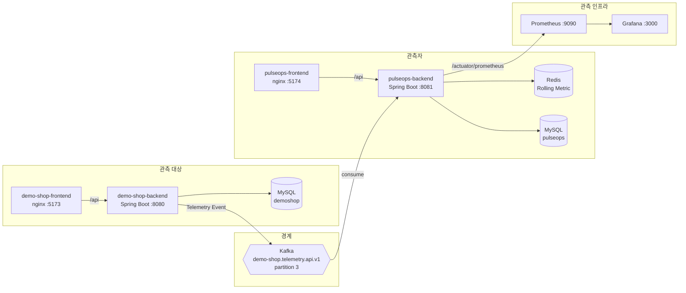
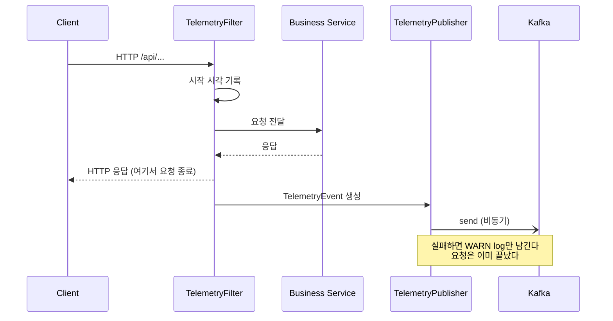
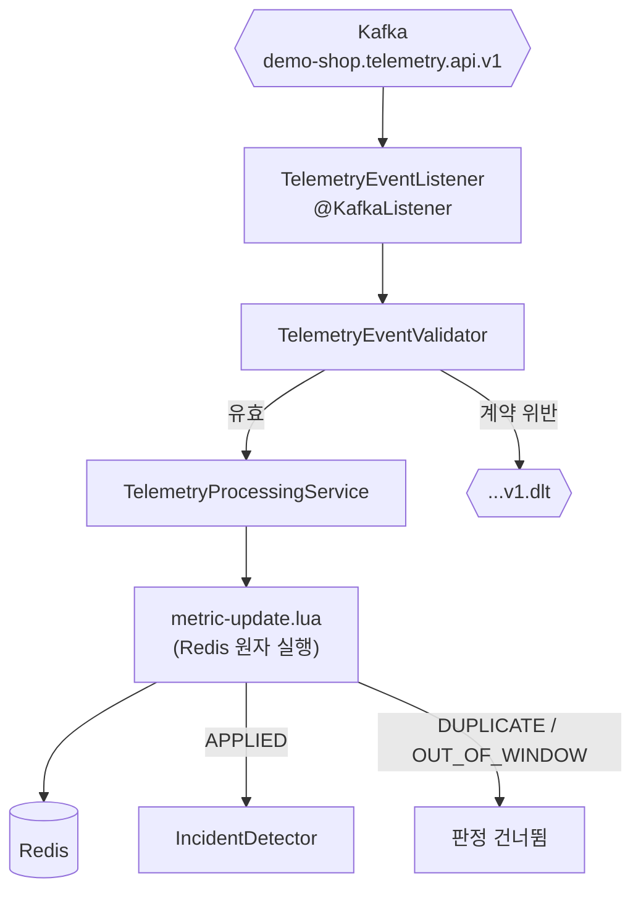
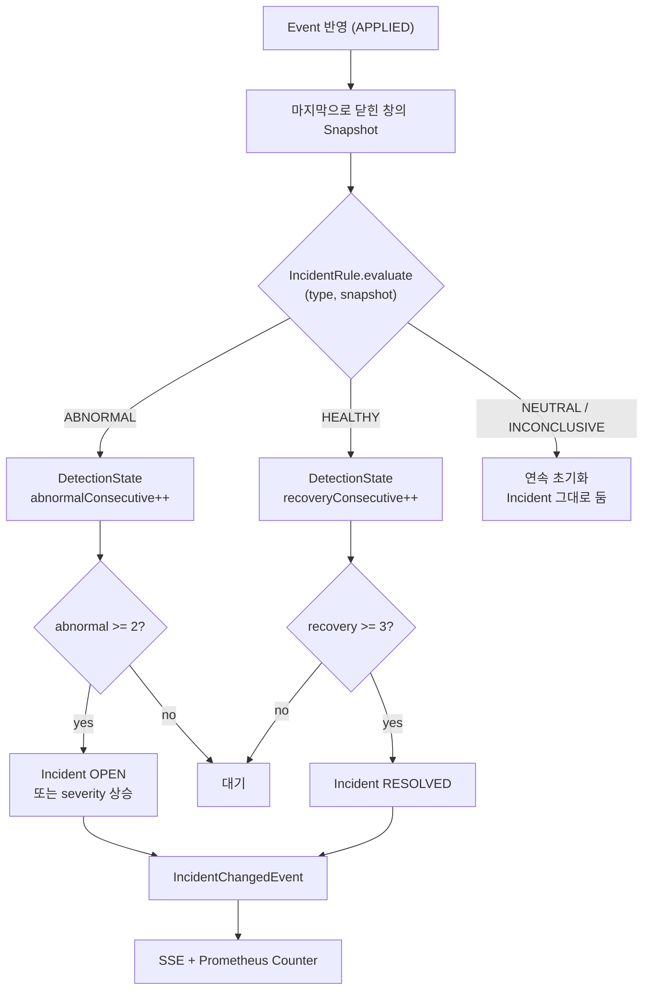
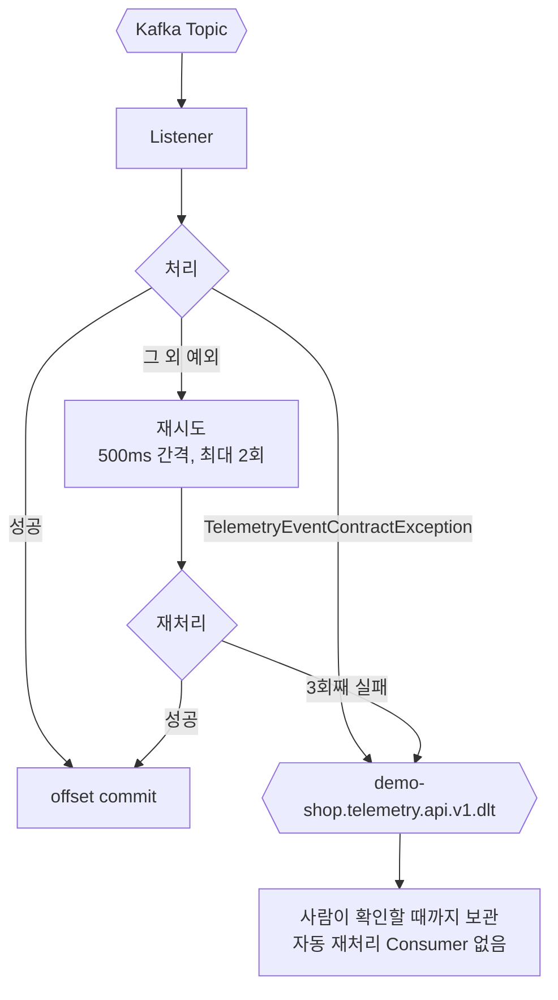
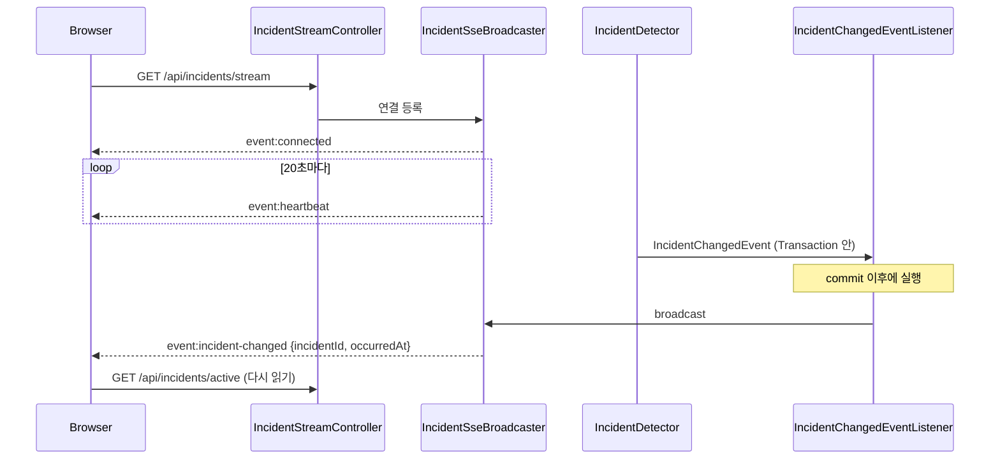
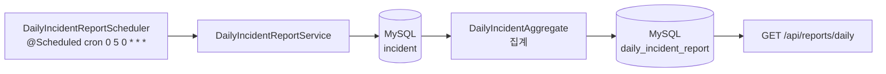
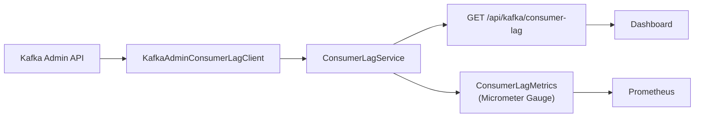
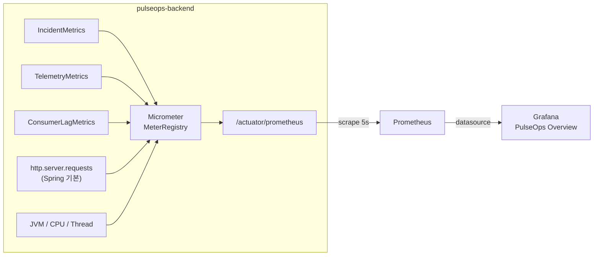
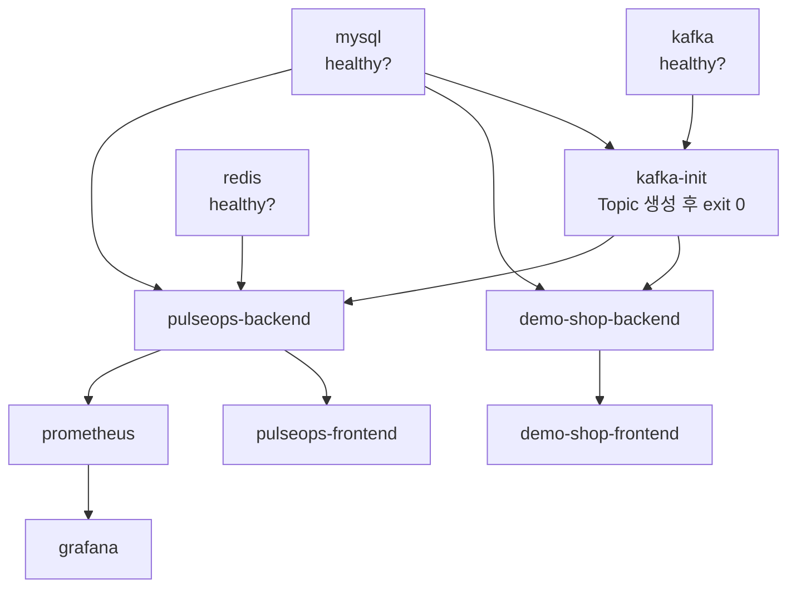

# Architecture

PulseOps는 두 개의 독립된 Spring Boot Application으로 이루어진다. 이 문서는 그 둘이 무엇을 책임지고
어떤 경로로 이어지는지를 현재 코드 기준으로 정리한다.

## 1. System Overview



두 Application 사이에는 **Kafka Topic 하나만** 있다. PulseOps는 Demo Shop의 Business Database에
접근하지 않으며, Demo Shop은 PulseOps의 존재를 알지 못한다.

이 경계가 중요한 이유는 Demo Shop의 요청이 PulseOps의 사정 때문에 실패하거나 느려지지 않아야 하기
때문이다. Telemetry 발행은 비동기이고, 실패해도 Business 응답을 막지 않는다.

## 2. Component Responsibilities

### Demo Shop (관측 대상)

| Component | 책임 |
| --- | --- |
| `ProductService` / `OrderService` / `PaymentService` | 상품, 주문, 결제 Business Logic |
| `RequestIdFilter` | 요청마다 `requestId` 부여 |
| `TelemetryFilter` | `/api/`로 시작하는 요청의 결과를 Telemetry Event로 만든다 |
| `TelemetryPublisher` | Event를 Kafka로 보낸다. 실패해도 요청을 살린다 |
| `FaultInjectionInterceptor` | 개발/데모용 장애 주입. 기본 비활성 |

Demo Shop은 **장애 여부를 판단하지 않는다.** 자기 응답이 느린지 실패했는지에 대한 판단을 내리지 않고
사실만 내보낸다.

### PulseOps (관측자)

| Component | 책임 |
| --- | --- |
| `TelemetryEventListener` | Kafka Consumer. Event 수신 |
| `TelemetryEventValidator` | 계약 검증 |
| `TelemetryProcessingService` | 검증된 Event를 Metric에 반영 |
| `RedisMetricStore` | Lua script로 Bucket 갱신 + 중복 제거 |
| `RollingMetricService` | 60초 창의 Snapshot 계산 |
| `IncidentRule` | 창 하나가 이상인지 정상인지 판정 (순수 계산) |
| `DetectionState` | 계열별 연속 횟수와 cursor 보존 |
| `IncidentDetector` | 판정 결과로 Incident를 열고, 올리고, 끝낸다 |
| `IncidentService` | Incident 조회와 확인 처리 |
| `IncidentSseBroadcaster` | 변경 사실을 SSE로 전달 |
| `DailyIncidentReportScheduler` | 하루치 Incident 집계 |
| `IncidentAiAnalysisService` | 사후 AI 분석 (사람이 요청할 때만) |
| `IncidentGitHubContextService` | 사후 코드 맥락 수집 (사람이 요청할 때만) |
| `ConsumerLagService` | Kafka Admin API로 lag 조회 (읽기 전용) |

## 3. Telemetry Flow

Demo Shop의 요청 하나가 Event가 되어 Kafka에 놓이기까지의 경로이다.



**응답이 Client에게 나간 뒤에 Event를 만든다.** Kafka가 느리거나 죽어 있어도 Demo Shop의 응답 시간이
늘어나지 않는다.

### Event 계약 (schemaVersion 1)

13개 field를 갖는다.

| field | 설명 |
| --- | --- |
| `eventId` | UUID. 중복 제거의 기준 |
| `schemaVersion` | 1 |
| `occurredAt` | 요청이 끝난 시각 |
| `service` | `demo-shop` |
| `serviceInstance` | `host:port` |
| `requestId` | 요청 추적용 |
| `method` | HTTP method |
| `endpoint` | **Route Template** (`/api/orders/{orderId}`), 실제 ID가 아니다 |
| `httpStatus` | 응답 상태 |
| `success` | `httpStatus < 400` |
| `latencyMs` | 응답 시간 |
| `errorType` | 오류 분류 |
| `errorMessage` | 오류 설명 |

**Request Body, Authorization Header, Cookie, 비밀번호는 Event에 들어가지 않는다.** `endpoint`가
실제 resource ID가 아닌 Route Template인 것도 같은 이유이며, 동시에 Metric 계열이 ID마다 쪼개지지
않게 한다.

Producer의 message key는 `service:endpoint`이다. 같은 계열의 Event가 같은 partition에 모여 순서대로
처리된다.

## 4. Metric Flow



### Redis 자료 구조

| Key | 형태 | 내용 | TTL |
| --- | --- | --- | --- |
| `pulseops:metric:{series}:{bucket}:counts` | HASH | `requestCount`, `errorCount` | 300s |
| `pulseops:metric:{series}:{bucket}:latency` | LIST | latency 표본 (최근 500개) | 300s |
| `pulseops:metric:series` | ZSET | 관측된 계열 목록 (score = bucket 시작) | 300s |
| `pulseops:dedup:event:{eventId}` | STRING | 중복 방지 표시 | 900s |

### 창 계약 (Phase 3에서 확정, 이후 변경 없음)

| 항목 | 값 |
| --- | --- |
| Bucket | 10초 |
| Rolling Window | 6 bucket = 60초 |
| Metric Key TTL | 300초 |
| dedup Key TTL | 900초 |
| latency 표본 상한 | Bucket당 최근 500개 |
| **오류의 정의** | **httpStatus ≥ 500 (5xx만)** |

4xx는 `requestCount`에만 들어간다. 잘못된 요청이 많은 것은 서비스의 이상이 아니므로 그것으로 Incident를
열지 않는다.

### 중복 제거

Lua script가 Redis 안에서 원자적으로 실행된다.

```
SET dedupKey '1' NX EX 900   -- 실패하면 이미 반영된 Event -> 0 반환, counter 미변경
HINCRBY counts requestCount 1
HINCRBY counts errorCount {0|1}
RPUSH latency {latencyMs}
LTRIM latency -500 -1
ZADD series {bucketStart} {seriesMember}
```

`SET NX`의 성공이 곧 "이 Event를 반영할 권리"이다. Redis는 script 실행 중 다른 Client의 명령을 끼워
넣지 않으므로, dedup 표시와 counter 증가 사이에 같은 Event의 다른 사본이 들어올 수 없다.

## 5. Incident Detection Flow



**Scheduler를 쓰지 않는다.** 판정은 Event가 도착해 Metric이 실제로 바뀌었을 때만 일어난다. 이것이
"실시간 Incident Detection에 Scheduler를 사용하지 않는다"는 규칙의 구현이다.

판정 대상은 언제나 **마지막으로 닫힌 창**이다. 지금 채워지는 중인 Bucket으로 판정하면 같은 구간이
볼 때마다 다른 값을 내어 한 구간이 이상과 정상 사이를 오가며 여러 번 세어진다.

같은 창을 두 번 세지 않는 근거는 `DetectionState`의 cursor 하나뿐이다. JVM 안의 기억은 재시작으로
사라지지만 DB의 상태는 남는다.

자세한 규칙과 기준선은 [incident-detection.md](incident-detection.md)에 있다.

## 6. Reliability Flow



계약 위반은 다시 읽어도 같은 결과이므로 재시도 없이 한 번에 DLT로 보낸다. 재시도가 시간만 쓴다.

자세한 내용은 [reliability.md](reliability.md)에 있다.

## 7. SSE Flow



`incident-changed`는 **Incident의 상태를 싣지 않는다.** ID와 시각만 보내고 화면은 REST로 다시 읽는다.
알림에 상태를 실으면 화면이 REST 응답과 알림 중 어느 쪽을 믿을지 정해야 하기 때문이다. Backend
Response가 언제나 최종 상태의 기준이다.

알림은 Transaction commit **이후에** 나간다. 되돌아간 Transaction의 변경이 화면에 먼저 보이지 않는다.

## 8. Daily Report Flow



Scheduler는 **시간 기반 작업에만** 쓴다. Spring의 `@Scheduled`를 쓰는 자리는 이 Application에서
**여기 하나뿐**이며, Incident 탐지에는 관여하지 않는다.

기동 시점에는 돌지 않는다. cron이 가리키는 시각(KST 00:05)에만 실행된다.

`IncidentSseHeartbeatScheduler`도 20초마다 도는 주기 작업이지만 `@Scheduled`가 아니라 자체
`ScheduledExecutorService`를 쓴다. 하는 일은 열려 있는 SSE 연결에 heartbeat를 보내 생존을 확인하는
것이고, Incident를 만들거나 판정하지 않는다.

## 9. Claude Analysis Flow

```mermaid
flowchart LR
    U["사람"] -->|POST /api/incidents/{incidentId}/analysis| C["IncidentAiAnalysisController"]
    C --> S["IncidentAiAnalysisService"]
    S --> E["Evidence 수집<br/>Incident + Metric 근거"]
    E --> P["IncidentAnalysisPrompt"]
    P --> CL["ClaudeIncidentAnalysisClient"]
    CL -->|HTTPS| API["Claude API"]
    API --> R["IncidentAnalysisResult"]
    R --> DB[("MySQL<br/>incident_ai_analysis")]
    DB --> UI["화면: Suggested Analysis"]
```

**이 경로는 Incident가 이미 만들어진 뒤에만 시작된다.** 그리고 시작점은 언제나 사람의 요청이다.
Incident 발생, Scheduler, SSE 알림 어디에서도 Claude를 부르지 않는다.

기본값은 꺼짐이다. 꺼져 있으면 `503 AI_ANALYSIS_UNAVAILABLE`을 반환하고 나머지 기능은 전부 그대로
동작한다.

자세한 경계는 [ai-github-boundary.md](ai-github-boundary.md)에 있다.

## 10. GitHub Context Flow

```mermaid
flowchart LR
    U["사람"] -->|POST /api/incidents/{incidentId}/github-context| C["IncidentGitHubContextController"]
    C --> S["IncidentGitHubContextService"]
    S --> EP["EndpointRoute<br/>endpoint -> 검색어"]
    EP --> GH["GitHubRestIncidentContextClient"]
    GH -->|code search| API1["GitHub API"]
    GH -->|commits| API2["GitHub API"]
    API1 --> F["source-root 안의 파일만 선택"]
    API2 --> CM["발생 직전 commit"]
    F --> DB[("MySQL<br/>incident_github_context")]
    CM --> DB
    DB -->|POST .../analysis/github| AI["Claude Code-Aware 분석"]
```

읽기 권한만 사용한다. commit도 branch도 PR도 만들지 않는다.

`source-root` 밖의 파일은 어떤 검색 결과로 나와도 선택하지 않는다. repository 전체가 외부 model로
흘러가는 일이 구조적으로 생기지 않게 하는 1차 안전 경계이다.

대상 repository는 요청 본문으로 받지 않고 설정에서만 온다. 그 자리를 열면 이 기능이 우리 token으로
아무 repository나 대신 읽어 주는 창구가 된다.

## 11. Consumer Lag Flow



**읽기 전용이다.** Consumer Lag은 Incident 판정의 입력이 아니다. Lag이 커져도 Incident가 열리지
않으며, 사람이 보기 위한 운영 지표일 뿐이다.

Gauge는 Kafka를 직접 부르지 않는다. 마지막으로 읽어 둔 표본만 내보내며, 표본이 오래되면
`pulseops_kafka_consumer_lag_snapshot_age_seconds`로 그 사실이 드러난다. Prometheus의 scrape가
외부 시스템을 기다리지 않게 하기 위해서이다.

## 12. Observability Flow



`management.endpoints.web.exposure.include`는 `health`와 `prometheus` **둘로 못박혀 있다.** 이
Application에는 인증 계층이 없으므로 Actuator에서 여는 것은 곧 공개하는 것이다. `*`를 열면 `env`와
`configprops`가 함께 열려 Claude API key와 GitHub token이 인증 없는 HTTP 응답으로 나간다.

Prometheus는 **PulseOps Backend만 긁는다.** Demo Shop은 scrape 대상이 아니다. 따라서 Prometheus의
`http_server_requests_*`는 PulseOps 자신의 REST API 값이며 Demo Shop의 응답 시간이 아니다.

노출되는 metric 이름은 [performance.md](performance.md) §9에 실측 목록이 있다.

## 13. Deployment / Compose Flow



기동 순서는 `depends_on`의 선언 순서가 아니라 **healthcheck**로 정해진다. MySQL이 연결을 받고, Kafka
Broker가 실제로 요청에 답하고, Topic이 만들어진 뒤에야 Application이 뜬다.

`kafka-init`이 Topic을 미리 만드는 이유는 자동 생성을 끄면 어느 Application이 먼저 뜨느냐가 partition
수를 정하게 되기 때문이다. 특히 PulseOps는 Telemetry Topic을 선언하지 않으므로 먼저 뜨면 없는 Topic을
구독한 채로 기다린다.

Container끼리는 service 이름이 그대로 hostname이다. Container 안의 `localhost`는 언제나 자기 자신이다.

## 14. 이 그림에 없는 것

의도적으로 없는 것들이다.

- **AI는 탐지 경로에 없다.** §5의 어느 화살표에도 Claude가 없다. AI는 §9의 별도 경로이며 Incident가
  만들어진 뒤 사람이 요청했을 때만 시작된다.
- **Consumer Lag은 판정 입력이 아니다.** §11은 §5로 이어지지 않는다.
- **Scheduler는 탐지에 없다.** §8의 Daily Report 하나뿐이다.
- **PulseOps → Demo Shop DB 화살표가 없다.** 두 Application은 Kafka Topic 하나로만 이어진다.
- **인증/인가 계층이 없다.** 로컬 데모 구성이기 때문이며, 그래서 Actuator를 둘로 좁혀 두었다.
