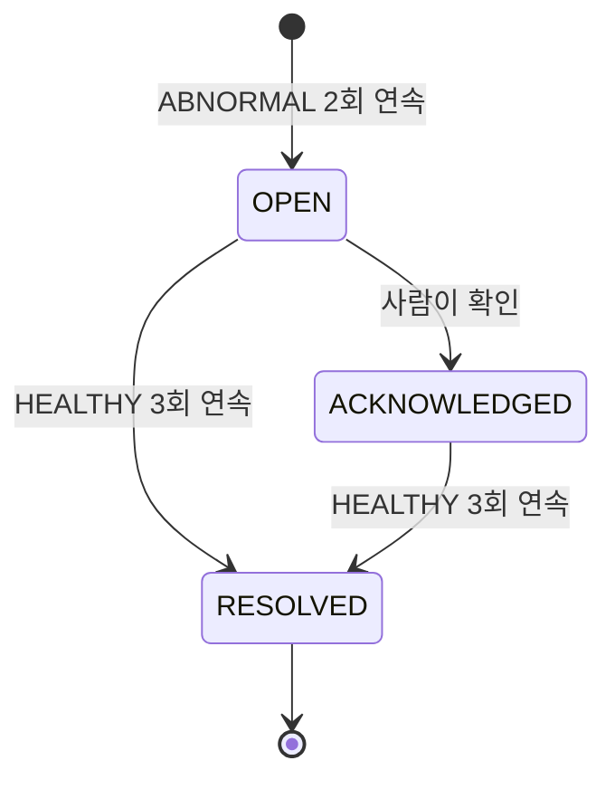

# Incident Detection

이 문서는 PulseOps가 무엇을 보고 Incident를 열고 끝내는지를 **현재 코드의 실제 값 기준으로** 정리한다.

기준선은 `IncidentRule`에, 연속 판정과 전이는 `IncidentDetector`에, 상태 보존은 `DetectionState`에
있다.

## 1. 판정 대상 — 계열(Series)

Incident는 **계열마다** 따로 판정된다. 계열은 셋으로 정해진다.

```
service + method + endpoint
```

예: `demo-shop` + `GET` + `/api/products`

`endpoint`는 실제 resource ID가 아니라 **Route Template**이다. `/api/orders/123`이 아니라
`/api/orders/{orderId}`이다. 그렇지 않으면 주문 하나마다 계열이 생겨 어느 창에도 판정에 필요한 요청
수가 모이지 않는다.

## 2. 판정 창 — Rolling Window

| 항목 | 값 |
| --- | --- |
| Bucket | **10초** |
| Window | **6 bucket = 60초** |
| 판정 대상 | **마지막으로 닫힌 창** |
| 창이 진행하는 간격 | 10초 (Bucket 하나) |

지금 채워지는 중인 Bucket은 판정하지 않는다. 값이 아직 들어오고 있어 같은 구간을 볼 때마다 다른
오류율이 나오고, 그 값으로 연속을 세면 한 구간이 이상과 정상 사이를 오가며 여러 번 세어진다.

창은 **완전히 닫힌 6개 Bucket**으로 이루어지고, 다음 창은 그 끝에서 10초 뒤이다.

### 판정 시점

**Scheduler가 아니다.** Kafka Event가 도착해 Metric이 실제로 바뀌었을 때 판정이 일어난다.
`OUT_OF_WINDOW`로 버려진 Event에서는 판정하지 않는다.

## 3. ERROR_RATE

### 오류의 정의

> **오류는 `httpStatus >= 500`뿐이다.**

4xx는 `requestCount`에만 들어가고 `errorCount`에는 들어가지 않는다. 잘못된 요청이 많은 것은 서비스의
이상이 아니므로 그것으로 Incident를 열지 않는다.

| 항목 | 값 |
| --- | --- |
| 분모 | 창의 전체 요청 수 (`requestCount`, 4xx 포함) |
| 분자 | 창의 5xx 응답 수 (`errorCount`) |
| 표현 | 0~100 백분율 |

### 기준선

| 판정 | 조건 |
| --- | --- |
| `INCONCLUSIVE` | `requestCount < 20` |
| `ABNORMAL` / **CRITICAL** | `errorRate >= 25.00%` |
| `ABNORMAL` / **WARNING** | `10.00% <= errorRate < 25.00%` |
| `NEUTRAL` | `3.00% <= errorRate < 10.00%` |
| `HEALTHY` | `errorRate < 3.00%` |

### 최소 트래픽 20건

요청이 20건보다 적은 창은 판정하지 않는다. 요청 두 건 중 한 건이 실패해도 오류율은 50%가 되지만,
그것으로 서비스가 아프다고 말할 수 없다.

### 완충 구간 (NEUTRAL)

이상 기준(10%)과 회복 기준(3%) 사이에는 판정하지 않는 구간이 있다. 두 기준이 같으면 값이 기준선에서
흔들릴 때마다 판정이 뒤집힌다.

`NEUTRAL`인 창에서는 **연속 횟수만 끊기고 Incident는 그대로 둔다.** 좋아졌다는 근거가 없는데 닫으면
아직 아픈 서비스가 조용해진다.

### 전이 조건

| 전이 | 조건 |
| --- | --- |
| Incident 열림 | `ABNORMAL`이 **2회 연속** |
| Incident 종료 | `HEALTHY`가 **3회 연속** |

Bucket이 10초이므로 열리기까지 최소 20초, 끝나기까지 최소 30초가 걸린다.

**회복 기준이 더 긴 것은 의도적이다.** 잘못 여는 것보다 잘못 닫는 것이 위험하다. 닫힌 뒤에는 아무도
그 장애를 보지 않는다.

## 4. LATENCY

### 판정 값

창의 **P95 응답 시간**이다. Bucket마다 최근 500개의 latency 표본을 남기고, 창의 표본을 모아 P95를
구한다.

### 기준선

| 판정 | 조건 |
| --- | --- |
| `INCONCLUSIVE` | `requestCount < 20` **또는** `p95LatencyMs == null` |
| `ABNORMAL` / **CRITICAL** | `p95 >= 3000ms` |
| `ABNORMAL` / **WARNING** | `1500ms <= p95 < 3000ms` |
| `NEUTRAL` | `500ms <= p95 < 1500ms` |
| `HEALTHY` | `p95 < 500ms` |

### P95가 없으면 판정하지 않는다

요청이 충분해도 표본이 없어 P95를 구하지 못했다면 `INCONCLUSIVE`이다. 구하지 못한 값을 0으로 읽으면
응답 시간을 재지 못한 창이 가장 빠른 창이 된다.

### 전이 조건

ERROR_RATE와 같다. `ABNORMAL` 2회 연속에 열리고, `HEALTHY` 3회 연속에 끝난다.

## 5. 두 종류는 독립이다

`ERROR_RATE`와 `LATENCY`는 **서로 다른 Incident**이다.

- 같은 계열에서 두 종류가 동시에 열릴 수 있다.
- 한쪽이 열려 있어도 다른 쪽은 독립적으로 판정된다.
- `DetectionState`도 종류마다 따로 있다.

느린 응답이 오류로 세어지지 않기 때문에, 3.5초 지연을 주입해도 `ERROR_RATE` Incident는 열리지 않는다.
이것은 [performance.md](performance.md) §7에서 실측으로 확인되었다.

두 종류를 한 Transaction에서 함께 처리한다. 나누면 오류율은 반영됐는데 응답 시간은 반영되지 않은 중간
상태가 남고, 그 사이에 멈추면 두 상태의 cursor가 어긋난 채로 이어진다.

판정은 언제나 `IncidentType` 선언 순서(`ERROR_RATE` → `LATENCY`)대로 돈다. 이것이 잠금 순서의 계약이다.

## 6. Identity — 처리 중인 Incident는 계열·종류당 하나

```
service | method | endpoint | type
```

같은 조합에 처리 중인(`OPEN` 또는 `ACKNOWLEDGED`) Incident가 둘 이상 생기지 않는다.

DB가 그것을 보장한다.

```sql
active_key VARCHAR(350) GENERATED ALWAYS AS (
    CASE
        WHEN status IN ('OPEN', 'ACKNOWLEDGED')
            THEN CONCAT(service, '|', method, '|', endpoint, '|', type)
    END
) STORED,
CONSTRAINT uk_incident_active UNIQUE (active_key)
```

`RESOLVED`가 되면 이 열이 `NULL`이 된다. UNIQUE Index는 NULL을 서로 다른 값으로 보므로 종료된
Incident는 이력으로 얼마든지 쌓인다.

Application이 이 값을 직접 채우지 않고 다른 열에서 파생시킨다. 직접 채우면 identity나 status를 바꿀 때
두 값이 어긋날 수 있고, 그 어긋남이 곧 중복 Incident를 뜻한다.

## 7. Lifecycle



| 상태 | 뜻 |
| --- | --- |
| `OPEN` | 열렸고 아무도 확인하지 않았다 |
| `ACKNOWLEDGED` | 사람이 확인했다. 아직 회복되지 않았다 |
| `RESOLVED` | 회복이 확인되어 끝났다 |

### 허용되는 전이

- `OPEN → ACKNOWLEDGED`
- `OPEN → RESOLVED`
- `ACKNOWLEDGED → RESOLVED`

### 금지되는 전이

- **`RESOLVED → OPEN`은 없다.** 같은 문제가 다시 발생하면 **새 Incident**를 만든다.
- `ACKNOWLEDGED → OPEN`도 없다.
- `RESOLVED → RESOLVED`는 예외를 던진다.

확인 처리는 `OPEN`일 때만 가능하다. 그 외 상태에서 부르면
`IncidentAcknowledgeNotAllowedException`이 된다.

### 회복은 확인 여부를 보지 않는다

Detector가 Incident를 끝낼 때 사람이 확인했는지 보지 않는다. **확인 여부는 사람의 일이고 회복은
서비스의 사실이다.** 따라서 `ACKNOWLEDGED`에서 곧바로 `RESOLVED`로 갈 수 있다.

## 8. Severity — 올라가기만 한다

| 값 | 순서 |
| --- | --- |
| `WARNING` | 낮음 |
| `CRITICAL` | 높음 |

Incident가 열린 뒤 severity는 **올라가기만 한다.**

- `WARNING`으로 열린 Incident가 `CRITICAL` 창을 만나면 `CRITICAL`로 올라간다.
- `CRITICAL`로 열린 Incident는 `WARNING` 창을 만나도 내려가지 않는다.

### 상승에는 연속이 필요 없다

여는 데에는 2회 연속이 필요하지만, 올리는 데에는 창 하나면 된다. 이미 열린 장애가 더 나빠진 것은 한
창만으로도 알려야 할 사실이고, 사람이 확인 중인 Incident도 악화 사실은 받아야 한다.

## 9. Trigger Evidence — 열렸을 때 무엇을 봤는가

Incident에는 그것을 연 창의 관측값이 그대로 남는다.

| 열 | 내용 |
| --- | --- |
| `trigger_window_start` / `trigger_window_end` | 연속을 완성한 창의 구간 |
| `trigger_request_count` | 그 창의 요청 수 |
| `trigger_error_count` | 그 창의 5xx 수 |
| `trigger_error_rate` | 그 창의 오류율 |
| `trigger_p95_latency_ms` | 그 창의 P95 (없으면 NULL) |

**이 값들은 생성 이후 바뀌지 않는다.** severity가 올라가도 그대로 둔다. "열렸을 때 무엇을 봤는가"가
남아야 하기 때문이다.

근거로 삼는 창은 **연속을 완성한 창**이다. 앞 창의 값을 남기면 Incident가 열린 시각과 그 안의 숫자가
서로 다른 구간을 가리킨다.

## 10. INCONCLUSIVE의 중요한 결과

> **트래픽이 멈추면 Incident는 저절로 끝나지 않는다.**

요청이 20건 미만인 창은 `INCONCLUSIVE`이고, `INCONCLUSIVE`에서는 Incident를 그대로 둔다.

따라서 장애가 난 뒤 트래픽 자체가 끊기면 그 Incident는 계속 열려 있다. 끝내려면 **정상 요청이 다시
흘러야** 한다.

이것은 결함이 아니라 선택이다. 조용해진 것과 나아진 것은 다르다. 아무도 부르지 않는 서비스를 "건강하다"고
판정하면, 완전히 죽어 요청조차 받지 못하는 서비스의 Incident가 조용히 닫힌다.

[performance.md](performance.md) §7의 `LATENCY` Incident #2가 실제로 이 상태로 남았다. 부하가 끝난 뒤
트래픽이 없어 `INCONCLUSIVE` 창만 이어졌고, Incident는 `OPEN`으로 유지되었다.

## 11. 판정 결과 네 가지 정리

| 결과 | 조건 | 연속 카운트 | Incident |
| --- | --- | --- | --- |
| `ABNORMAL` | 기준선 초과 | abnormal++ , recovery=0 | 2회 연속 시 열림/상승 |
| `HEALTHY` | 회복 기준선 미만 | recovery++ , abnormal=0 | 3회 연속 시 종료 |
| `NEUTRAL` | 두 기준선 사이 | 둘 다 0 | 그대로 |
| `INCONCLUSIVE` | 트래픽 부족 / P95 없음 | 둘 다 0 | 그대로 |

### 연속은 창이 이어질 때만 누적된다

창이 한 칸(10초) 건너뛰면 연속이 끊기고 0에서 다시 시작한다. 관측되지 않은 구간을 이상이 이어진 것으로
치지 않기 위해서이다. 자세한 내용은 [reliability.md](reliability.md) §6에 있다.

## 12. 기준선 요약표

| | ERROR_RATE | LATENCY |
| --- | --- | --- |
| 판정 값 | 창의 5xx 비율 | 창의 P95 |
| 최소 트래픽 | 20건 | 20건 |
| CRITICAL | >= 25.00% | >= 3000ms |
| WARNING | >= 10.00% | >= 1500ms |
| 회복(HEALTHY) | < 3.00% | < 500ms |
| 열림 조건 | ABNORMAL 2회 연속 | ABNORMAL 2회 연속 |
| 종료 조건 | HEALTHY 3회 연속 | HEALTHY 3회 연속 |
| 최소 개설 시간 | 20초 | 20초 |
| 최소 종료 시간 | 30초 | 30초 |

## 13. 관측 지표

| Metric | 뜻 |
| --- | --- |
| `pulseops_incidents_active{type,severity}` | 지금 처리 중인 Incident 수 |
| `pulseops_incidents_opened_total{type,severity}` | 지금까지 열린 누적 수 |
| `pulseops_incidents_resolved_total{type}` | 지금까지 끝난 누적 수 |

`opened_total`에는 severity tag가 있고 `resolved_total`에는 없다. 열릴 때의 severity는 그 시점의 사실이지만,
끝날 때의 severity는 상승을 거친 결과라 같은 의미를 갖지 않기 때문이다.

## 14. AI는 이 경로에 없다

이 문서의 어느 판정에도 AI가 개입하지 않는다. **Incident를 여는 것도 끝내는 것도 규칙과 숫자뿐이다.**

Claude는 Incident가 이미 만들어진 뒤, 사람이 요청했을 때만 사후 분석을 돕는다. 자세한 경계는
[ai-github-boundary.md](ai-github-boundary.md)에 있다.

Consumer Lag도 판정의 입력이 아니다. Lag이 커져도 Incident는 열리지 않는다.
