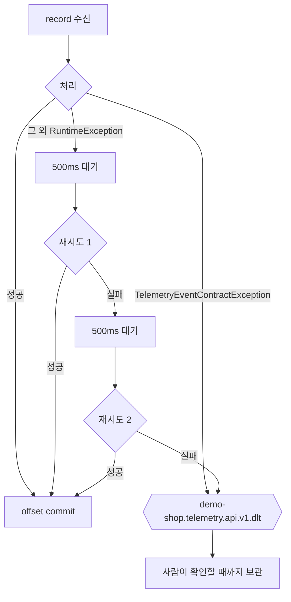

# Reliability

이 문서는 Telemetry가 Demo Shop에서 PulseOps의 Metric에 도달하기까지 **무엇이 보장되고 무엇이
보장되지 않는지**를 정리한다.

가장 먼저 밝혀 둘 것이 있다.

> **PulseOps는 end-to-end exactly-once가 아니다.**
> **end-to-end 전달 보장(guaranteed delivery)도 하지 않는다.**

정확한 표현은 다음과 같다.

> Kafka에 성공적으로 publish된 record에 대해, PulseOps Consumer의 처리는 at-least-once semantics를
> 가지며 Redis dedup으로 중복 반영을 막는다.
> Producer가 fail-open이므로 publish 자체가 실패한 구간의 Telemetry는 유실될 수 있다.

## 1. Producer Semantics — fail-open / best-effort

Demo Shop의 `TelemetryPublisher`는 **관측을 위해 Business를 희생하지 않는다.**

```java
this.kafkaTemplate.send(TOPIC, keyOf(event), payload)
    .whenComplete((result, failure) -> logDelivery(event, failure));
```

| 특성 | 값 |
| --- | --- |
| 발행 시점 | HTTP 응답이 Client에게 나간 **뒤** |
| 실패 처리 | WARN log만 남긴다. 요청은 이미 끝났다 |
| `max.block.ms` | 500ms |
| `delivery.timeout.ms` | 10,000ms |
| `request.timeout.ms` | 5,000ms |

기본값(전달 120초, 요청 30초)을 쓰지 않고 짧게 줄인 이유는, Broker 장애가 Demo Shop의 API 응답 시간으로
번지지 않게 하기 위해서이다.

### 결과: 유실 가능 구간

- Kafka Broker가 죽어 있는 동안의 Event
- `delivery.timeout.ms`를 넘긴 Event
- Demo Shop이 Event를 만든 뒤 발행 전에 죽었을 때의 Event

**이 Event들은 PulseOps에 영영 도착하지 않는다.** 그리고 PulseOps는 그 사실을 알 방법이 없다. 오지 않은
Event와 애초에 없던 요청을 구분할 수 없기 때문이다.

이것은 결함이 아니라 선택이다. 관측 Event 하나를 지키려고 사용자의 주문을 실패시키지 않는다.

## 2. Consumer Semantics — at-least-once

PulseOps의 `TelemetryEventListener`는 Kafka의 기본 semantics인 at-least-once를 전제로 한다.

같은 `eventId`가 반복 전달될 수 있다고 가정한다. 이유는 최소 셋이다.

1. offset commit 전에 Consumer가 죽으면 그 구간을 다시 읽는다.
2. rebalance 중 partition 재할당이 일어나면 처리 중이던 record가 다시 온다.
3. 처리 실패 후 재시도가 같은 record를 다시 넘긴다.

## 3. Duplicate 방지 — Redis dedup

중복 전달은 막지 못한다. 막는 것은 **중복 반영**이다.

`metric-update.lua`가 Redis 안에서 원자적으로 실행된다.

```
SET pulseops:dedup:event:{eventId} '1' NX EX 900
  -> 실패하면 이미 반영된 Event. 0을 반환하고 counter를 건드리지 않는다.
  -> 성공하면 이 호출이 이 Event를 반영할 권리를 얻는다.
```

Redis는 script를 실행하는 동안 다른 Client의 명령을 끼워 넣지 않는다. 따라서 dedup 표시와 counter
증가 사이에 같은 Event의 다른 사본이 들어올 수 없다.

만료(`EX 900`)는 `SET NX`가 성공하는 이 자리에서만 정해진다. 중복 호출이 dedup 표시의 수명을 늘리지
못한다.

### dedup TTL 900초의 의미

**900초를 넘겨 다시 도착한 Event는 다시 반영된다.**

이 창을 무한히 늘리지 않는 이유는 Redis에 Event ID를 영원히 쌓을 수 없기 때문이다. 900초는 Metric
TTL(300초)의 3배로, 재시도와 짧은 재시작으로 인한 중복을 덮을 만큼 넉넉하다.

다만 Metric Key는 300초에 사라지므로, 900초 사이에 다시 온 Event는 대개 이미 사라진 Bucket을 가리킨다.
그 경우는 아래 `OUT_OF_WINDOW`로 걸러진다.

## 4. 처리 결과 세 가지

`MetricRecordOutcome`은 다음 셋이다.

| 결과 | 뜻 | Incident 판정 |
| --- | --- | --- |
| `APPLIED` | 이번 호출이 Metric을 바꿨다 | **수행한다** |
| `DUPLICATE` | 이미 반영된 Event였다 | **수행한다** |
| `OUT_OF_WINDOW` | 반영하기에 너무 오래되었거나 너무 미래이다 | 건너뛴다 |

`DUPLICATE`에서도 판정을 수행하는 것이 중요하다. 중복이라는 것은 다른 사본이 Metric을 이미 바꿨다는
뜻이고, 그 사본의 처리가 판정까지 마쳤는지는 알 수 없다. 판정 자체가 idempotent하므로 다시 해도
안전하다.

`OUT_OF_WINDOW`의 경계는 `MetricWindow`가 정한다.

| 항목 | 값 |
| --- | --- |
| 과거 허용 | 300초 |
| 미래 허용 | 5초 |

미래를 5초만 허용하는 것은 시계 오차를 감안한 값이다. 그보다 먼 미래의 Event는 계약을 신뢰할 수 없다.

## 5. Retry와 DLT



| 항목 | 값 |
| --- | --- |
| `FixedBackOff` 간격 | 500ms |
| `maxAttempts` (재시도 횟수) | 2 |
| **총 처리 시도** | **3회** (최초 1 + 재시도 2) |
| DLT Topic | `demo-shop.telemetry.api.v1.dlt` |
| DLT partition | 3 (원본과 동일) |
| DLT replication factor | 1 |

### 계약 위반은 재시도하지 않는다

`TelemetryEventContractException`은 `addNotRetryableExceptions`에 등록되어 있다. 계약을 어긴 payload는
다시 읽어도 같은 결과이므로 재시도가 시간만 쓴다. **한 번 만에 DLT로 보낸다.**

### 계약 위반의 종류

`TelemetryEventValidator`가 판정한다.

**구조 검증** — 13개 필수 field 중 하나라도 없으면 위반이다.

`eventId`, `schemaVersion`, `occurredAt`, `service`, `serviceInstance`, `requestId`, `method`,
`endpoint`, `httpStatus`, `success`, `latencyMs`, `errorType`, `errorMessage`

**값 검증**

| 규칙 | 위반 예 |
| --- | --- |
| `schemaVersion == 1` | 지원하지 않는 version |
| `occurredAt != null` | |
| `eventId`, `service`, `serviceInstance`, `requestId`, `method`, `endpoint` 비어 있지 않음 | |
| `100 <= httpStatus <= 599` | 범위 밖 |
| `latencyMs >= 0` | 음수 |
| `success == (httpStatus < 400)` | 두 값이 어긋남 |

마지막 규칙이 중요하다. `success`가 `httpStatus`와 어긋나면 **Consumer가 값을 다시 계산해 고치지
않는다.** 그대로 걸러 낸다. 계약을 깬 것은 Producer이고, Consumer가 조용히 고치면 계약이 깨진 사실이
아무 데도 남지 않는다.

### DLT를 다시 읽는 Consumer는 없다

DLT는 사람이 원인을 확인할 때까지 붙잡아 두는 자리이다. 자동 재처리 Consumer를 두면 계약을 어긴
record가 무한히 도는 경로가 생긴다.

### DLT 전송이 실패하면

`DeadLetterPublishingRecoverer`가 예외를 올려 보낸다. offset이 넘어가지 않으므로 그 record는 사라지지
않고 다시 처리된다.

## 6. Incident 판정의 idempotency

판정을 여러 번 해도 결과가 달라지지 않는다. 근거는 `DetectionState`의 cursor 하나이다.

```java
if (!snapshot.windowEnd().isAfter(state.getLastEvaluatedWindowEnd())) {
    return;   // 이미 본 창이면 여기서 끝낸다
}
```

### 왜 JVM 안의 기억이 아니라 DB인가

JVM 안의 기억은 재시작이나 Instance 추가로 사라진다. DB의 상태는 남는다. 두 기준이 어긋나면 어느 쪽이
맞는지 말할 수 없게 된다.

`DetectionState`는 `SELECT ... FOR UPDATE`로 잠근 뒤에만 갱신한다. 같은 계열의 Event가 같은 partition에
모이므로 정상 경로에서는 경합이 없지만, 잠금은 그것에 기대지 않는다.

### 연속 횟수는 창이 이어질 때만 누적된다

```java
boolean consecutive = windowEnd.equals(this.lastEvaluatedWindowEnd.plusSeconds(MetricWindow.BUCKET_SECONDS));
int abnormalBefore = consecutive ? this.abnormalConsecutive : 0;
```

창이 한 칸(10초) 건너뛰면 연속이 아니다. 연속 횟수가 0에서 다시 시작한다.

이것은 보수적인 선택이다. 관측되지 않은 구간을 이상이 이어진 것으로 치지 않는다. 대가로, Consumer가
잠시 멈췄다 돌아온 직후에는 Incident가 열리기까지 조금 더 걸린다.

### 잠금 순서

교착을 피하기 위해 언제나 같은 순서로 잠근다.

1. `IncidentType` 선언 순서대로 (`ERROR_RATE` → `LATENCY`)
2. 종류 안에서는 `DetectionState` → `Incident`

두 처리가 서로 반대 순서로 잠그면 서로를 기다리다 둘 다 멈춘다.

### Redis 읽기는 Transaction 밖에서

`IncidentDetector.detect()`는 Redis Snapshot을 먼저 읽고 그 다음에 Transaction을 연다. Redis 읽기를
Transaction 안에 넣으면 Redis가 느릴 때 MySQL 행 잠금이 그 시간만큼 함께 붙들려, Metric 저장소의
지연이 다른 처리의 판정까지 막는다.

## 7. Failure Boundary — 무엇이 어디까지 번지는가

| 고장 | 영향 범위 | Demo Shop Business |
| --- | --- | --- |
| Kafka Broker 정지 | Telemetry 유실 (fail-open) | **영향 없음** |
| PulseOps Backend 정지 | Metric 갱신 정지, Consumer Lag 증가 | **영향 없음** |
| Redis 정지 | Metric 반영 실패 → 재시도 → DLT | **영향 없음** |
| PulseOps MySQL 정지 | Incident 저장 실패 → 재시도 → DLT | **영향 없음** |
| Demo Shop MySQL 정지 | Demo Shop 5xx | 영향 있음 |
| Claude API 장애 | AI 분석만 실패 (503) | **영향 없음** |
| GitHub API 장애 | 코드 맥락 수집만 실패 (503) | **영향 없음** |

Demo Shop의 Business Request는 PulseOps 쪽의 어떤 고장으로도 실패하거나 느려지지 않는다. 이것이 두
Application을 나눈 이유이다.

### Redis 읽기 실패는 빈 Metric으로 바꾸지 않는다

Phase 3에서 확정된 계약이다. Redis를 읽지 못했을 때 "요청 0건, 오류 0건"으로 응답하면 아픈 서비스가
조용한 서비스와 구분되지 않는다. 실패는 실패로 올려 보낸다.

### Redis 쓰기 실패는 Kafka 소비를 멈추지 않는다

계열 registry 등록처럼 Metric의 의미에 관여하지 않는 부산물 write는 실패해도 WARN 후 건너뛴다.
Metric 본체의 write 실패는 예외로 올라가 재시도와 DLT 경로를 탄다.

## 8. 관측 지표

신뢰성 상태를 밖에서 볼 수 있는 지표이다.

| Metric | 뜻 |
| --- | --- |
| `pulseops_telemetry_events_processed_total{result="applied"}` | 실제로 Metric을 바꾼 Event 수 |
| `pulseops_telemetry_events_processed_total{result="duplicate"}` | 중복으로 걸러진 Event 수 |
| `pulseops_telemetry_events_processed_total{result="out_of_window"}` | 창을 벗어나 버려진 Event 수 |
| `pulseops_telemetry_events_failed_total` | 처리 중 예외가 난 횟수 |
| `pulseops_telemetry_events_rejected_total` | 계약 위반으로 거절된 Event 수 |
| `pulseops_kafka_consumer_lag` | Consumer가 얼마나 뒤처져 있는가 |
| `pulseops_kafka_consumer_lag_snapshot_age_seconds` | 위 값이 얼마나 오래된 표본인가 |

`duplicate`가 0보다 크다면 at-least-once 재전달이 실제로 일어났고 dedup이 그것을 막았다는 뜻이다.

`rejected`가 늘어난다면 Producer가 계약을 어기고 있다는 뜻이며, DLT를 확인해야 한다.

## 9. 실측 기록

Phase 14 검증에서 관측된 값이다. 자세한 조건은 [performance.md](performance.md)에 있다.

| 항목 | 값 |
| --- | --- |
| Kafka partition 0 `logEndOffset` | 8,608 |
| `processed_total{result="applied"}` | 8,608 |
| `processed_total{result="duplicate"}` | 0 |
| `processed_total{result="out_of_window"}` | 0 |
| `failed_total` | 0 |
| `rejected_total` | 0 |
| 최대 관측 Consumer Lag | 1 |

Kafka에 기록된 수와 반영된 수가 정확히 같았다.

**이것은 exactly-once의 증명이 아니다.** 재시도도 Consumer 재시작도 Redis 장애도 일어나지 않은 구간의
관측이며, 그 조건에서 at-least-once 처리와 dedup이 결과적으로 정확히 한 번을 만들어 냈다는 기록이다.
Consumer를 부하 중 재시작하거나 Redis를 끊는 실험은 하지 않았다.

## 10. 요약: 말할 수 있는 것과 없는 것

**말할 수 있다**

- Kafka에 성공적으로 publish된 record에 대해 PulseOps의 처리는 at-least-once이다.
- 같은 `eventId`의 중복 반영은 Redis dedup(TTL 900초)이 막는다.
- 처리 실패는 500ms 간격으로 총 3회까지 시도되고, 그래도 실패하면 DLT로 격리된다.
- 계약 위반은 재시도 없이 한 번에 DLT로 간다.
- Incident 판정은 `DetectionState` cursor 덕분에 여러 번 실행해도 같은 결과를 낸다.
- PulseOps 쪽의 어떤 고장도 Demo Shop의 Business Request를 실패시키지 않는다.

**말할 수 없다**

- ~~end-to-end exactly-once~~ — Producer가 fail-open이다.
- ~~guaranteed delivery~~ — Kafka 장애 구간의 Event는 유실된다.
- ~~zero data loss~~ — 위와 같다.
- ~~fault tolerant~~ / ~~high availability~~ — 모든 구성 요소가 Instance 하나이고 Kafka replication
  factor는 1이다.
- 900초를 넘겨 다시 온 Event가 중복 반영되지 않는다 — 그 창 밖에서는 dedup이 동작하지 않는다.
  (다만 그런 Event는 대개 `OUT_OF_WINDOW`로 걸러진다.)
